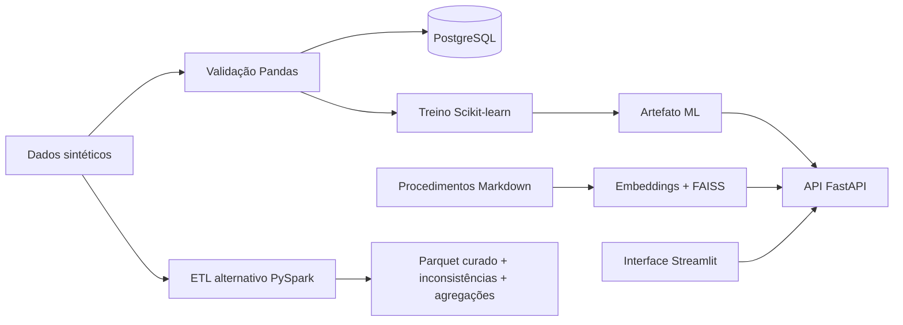

# Industrial Quality Monitor

**Projeto de portfólio em Engenharia de Dados e IA aplicada à qualidade industrial.** Um fluxo ponta a ponta, didático e reproduzível, que gera dados sintéticos, valida e persiste inspeções, treina um modelo de classificação e expõe previsões e consulta documental por API e interface gráfica.

> **Escopo educacional:** todos os dados e procedimentos deste repositório são sintéticos. O modelo não foi validado em ambiente industrial e não deve orientar inspeções, descarte ou liberação de produtos reais.

## Sobre o autor

**Paulo Henryque Marcon Xavier Parente** é formado em Gestão da Produção Industrial, com pós-graduações lato sensu em **Engenharia da Qualidade, com ênfase em Gestão** (2025) e **Engenharia de Produção e Gerenciamento de Projetos** (2026). Tem experiência em qualidade e processos industriais, implantação e migração de ERP, indicadores e automação de tarefas com VBA, Python, SQL e ferramentas de IA generativa.

Está em transição para **AI Engineering, Data Engineering / Analytics e DevOps Engineering**, aprofundando Python, ciência de dados e Power BI. Este projeto conecta sua experiência em produção, qualidade e processos a práticas de dados, machine learning, APIs e operação de aplicações. Foi construído como material didático para evolução profissional, com foco em compreender, revisar e validar cada parte do fluxo.

**Perfis:** [LinkedIn](https://www.linkedin.com/in/paulo-henryque-marcon-xavier-parente-942094157/) · [GitHub](https://github.com/phdataengineering). Aberto a conversas sobre oportunidades e colaboração técnica.

## O que o projeto demonstra

- Geração determinística e validação de dados com Python e Pandas.
- Persistência em PostgreSQL e consultas analíticas em SQL.
- Pipeline Scikit-learn com pré-processamento, avaliação e artefato versionado por metadados.
- RAG local com documentos Markdown, embeddings Hugging Face e busca vetorial FAISS (busca exata NumPy no Windows).
- API REST com FastAPI, validação de entradas e readiness/liveness.
- Interface Streamlit com simulador de defeitos e consulta a procedimentos.
- Empacotamento e orquestração local com Docker Compose.
- Pipeline ETL alternativo em PySpark para validação distribuível, saída Parquet e agregações.

## Fluxo e arquitetura



O PostgreSQL dá suporte à persistência e às análises de inspeção. A API carrega o artefato ML localmente e não consulta o banco durante uma predição. O frontend acessa a API pelo endereço interno `industrial-api:8000` na rede Compose.

O ETL PySpark é opcional e executa em perfil separado. Ele lê o CSV bruto, aplica as regras de qualidade, preserva as colunas e tipos da inspeção no Parquet curado e gera saídas de inconsistências e indicadores por turno/produto. Não altera o schema SQL nem substitui o ETL Pandas padrão. A interface mostra um diagrama didático desse fluxo; neste repositório, `local[2]` demonstra o processamento por partições em uma máquina, não um cluster distribuído.

## Interface

A interface Streamlit contém duas abas:

1. **Simulador de defeitos:** recebe turno, produto, operador e quantidade inspecionada; apresenta a classe prevista e a probabilidade estimada.
2. **Consulta aos procedimentos:** envia uma pergunta aos documentos do projeto e exibe a resposta e suas fontes.

A predição aceita os valores usados no treinamento: turnos `diurno`, `tarde` e `noturno`; produtos `A` a `D`; operadores `OP01` a `OP08`; quantidade positiva. A pergunta ao RAG é limitada a 500 caracteres.

## Tecnologias

| Área | Tecnologias |
| --- | --- |
| Dados e validação | Python, Pandas, pytest |
| ETL escalável opcional | Apache Spark / PySpark, Parquet |
| Persistência e análise | PostgreSQL, SQLAlchemy, SQL |
| Machine learning | Scikit-learn, joblib |
| RAG | LangChain Core, LangChain Hugging Face, sentence-transformers, FAISS |
| API e interface | FastAPI, Pydantic, Streamlit |
| Execução | Docker, Docker Compose |

O índice usa `faiss-cpu` diretamente em Linux/Docker; no Windows usa busca exata NumPy para evitar falhas de carregamento da DLL nativa. O projeto não depende do pacote `langchain-community` descontinuado.

## Executar com Docker Compose

Requer Docker com Compose. Na configuração padrão, a interface fica em `http://localhost:8501`, a API em `http://localhost:8001` e o PostgreSQL em `localhost:5432`.

```bash
docker compose up --build
```

O primeiro build gera e valida os dados sintéticos e treina o artefato ML. O PostgreSQL aplica `sql/schema.sql` quando o volume é criado. A API só fica pronta depois de carregar o modelo; o frontend aguarda essa prontidão. A documentação interativa da API fica em `http://localhost:8001/docs`.

Se as portas padrão estiverem ocupadas, defina `FRONTEND_PORT`, `API_PORT` ou `POSTGRES_PORT` antes de iniciar. Para encerrar os serviços, use `docker compose down`. Use `docker compose down -v` apenas se também quiser apagar o volume local do PostgreSQL.

A primeira consulta ao RAG pode demorar enquanto os modelos Hugging Face são baixados. O PyTorch do container usa a variante CPU.

### Executar o ETL Spark opcional

Gere os dados brutos no workspace e execute apenas o serviço do perfil Spark:

```bash
python src/gerar_dados.py
docker compose --profile spark run --rm spark-etl
```

As saídas Parquet são gravadas em `data/processed/spark/`. Esse perfil usa uma imagem própria com Java e PySpark e não é iniciado no `docker compose up` padrão. PySpark 4 requer Java 17 ou superior; veja os [requisitos oficiais de instalação](https://spark.apache.org/docs/latest/api/python/getting_started/install.html).

Em hosts Linux, a imagem cria o usuário sem privilégios com UID/GID `1000:1000` para gravar os resultados no diretório montado. Se sua conta usar outros IDs, defina `SPARK_UID` e `SPARK_GID` no ambiente antes de construir a imagem.

## Executar sem Docker

Requer Python 3.11+ e PostgreSQL. Instale as dependências, gere os dados e treine o modelo:

```bash
python -m venv .venv
# Windows PowerShell: .venv\Scripts\Activate.ps1
pip install -r requirements.txt
python src/gerar_dados.py
python src/validar_dados.py
python src/treinar_modelo.py
```

Crie o banco, aplique `sql/schema.sql` e configure `DB_USER`, `DB_PASSWORD`, `DB_HOST`, `DB_PORT` e `DB_NAME` no `.env`. Em seguida, carregue as inspeções e inicie a API:

```bash
python src/carregar_postgres.py
uvicorn src.api:app --host 127.0.0.1 --port 8001
```

Para iniciar o frontend fora do Compose, instale `frontend/requirements.txt` e defina `API_BASE_URL=http://localhost:8001` antes de executar `streamlit run frontend/app.py`.

## Testes e validação

```bash
python -m pytest -q
```

A suíte cobre geração/validação, regras do RAG, contratos dos handlers da API e a busca vetorial sem baixar modelos. A validação local mais recente registrou **37 testes aprovados e 3 subtestes**; também foram construídas as imagens Docker da API e do frontend, e a interface foi executada com verificação das duas abas e da comunicação com a API no Compose.

O teste adicional do ETL Spark em `tests/test_etl_spark.py` requer PySpark e Java 17 ou superior; sem a dependência opcional, ele é ignorado pela suíte. Nesta revisão, o container Spark processou 1.000 registros válidos, e um fixture com dados inválidos produziu 1 registro válido e 6 inconsistências com motivos verificáveis. O AppTest do Streamlit confirmou as duas abas e um diagrama Graphviz sem exceções.

## Reprodutibilidade e operação

- Seed fixa `42` para geração e treinamento sintéticos.
- O artefato ML registra versão do artefato/modelo, seed, features e threshold.
- `/health` verifica liveness sem iniciar downloads; `/ready` indica se o modelo ML foi carregado.
- Frontend e API rodam em containers separados, sem privilégios de root.
- Portas publicadas pelo Compose ficam vinculadas a `127.0.0.1` por padrão.
- `.env`, dados locais e artefatos não são enviados no contexto Docker nem versionados.

## Limitações

- Os dados são artificiais e contêm um sinal de defeito por turno inserido intencionalmente.
- Métricas de teste refletem somente esse conjunto sintético e não indicam desempenho em produção.
- A probabilidade do modelo não é uma avaliação industrial validada.
- O RAG responde com base nos documentos didáticos deste repositório; respostas generativas podem falhar e devem ser conferidas na fonte.
- A aplicação é uma demonstração local, sem autenticação ou controles para exposição pública.

Detalhes adicionais em [docs/limitacoes.md](docs/limitacoes.md) e [docs/arquitetura.md](docs/arquitetura.md).

## Contato

Este projeto é um material aberto para aprendizado e demonstração profissional. Para conversar sobre o projeto, oportunidades ou colaboração, entre em contato pelo [LinkedIn](https://www.linkedin.com/in/paulo-henryque-marcon-xavier-parente-942094157/) ou pelo [GitHub](https://github.com/phdataengineering).

## Licença

MIT. Consulte [LICENSE](LICENSE).
